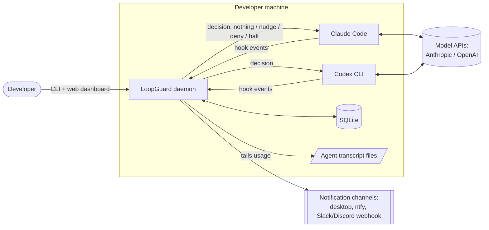
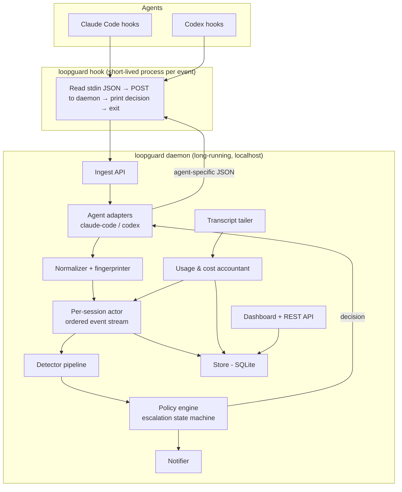
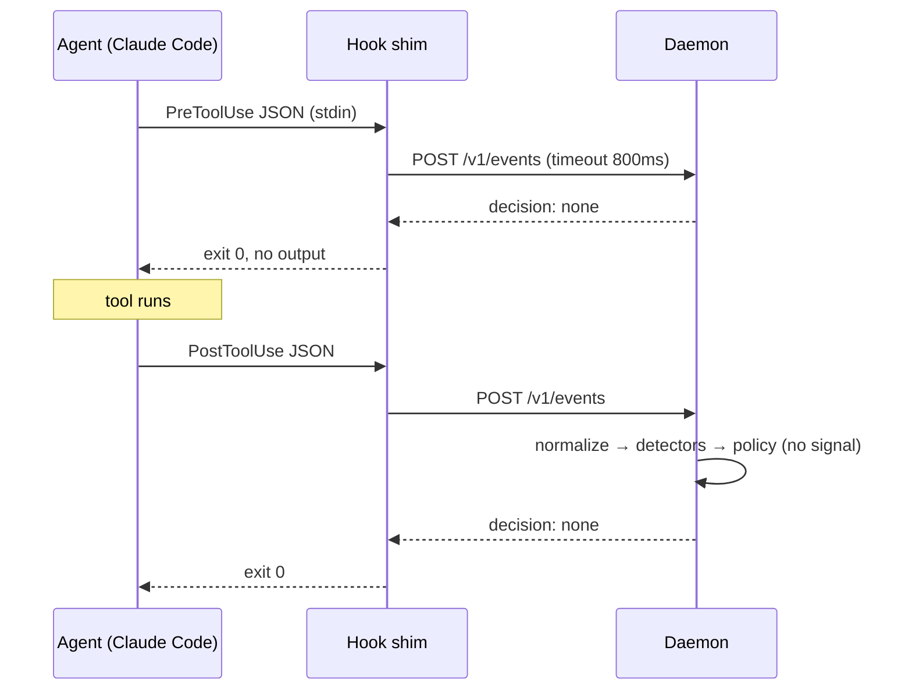

# LoopGuard: High-Level Design (HLD)

> Working name: **LoopGuard**. Check name availability (GitHub, npm, Homebrew, domain) before the first public release.

| | |
|---|---|
| Status | Draft v0.1 |
| Date | 2026-10-19 |
| Related docs | [LLD.md](./LLD.md), [TDD.md](./TDD.md), [plan.md](./plan.md) |

---

## 1. What we are building

LoopGuard is a local tool that watches AI coding agents (Claude Code, OpenAI Codex CLI, and later others) while they work. It detects when an agent is stuck in an unproductive loop, nudges it out, and stops it if it keeps going. It also tracks how many tokens, how much money (or usage quota), and how much time each session uses.

**One-line pitch:** *"A circuit breaker for AI agents. Stops your agent from burning money and time going in circles."*

### 1.1 The problem

In auto mode, agents sometimes:

- run the same failing test command over and over with tiny, useless changes,
- edit a line one way, revert it, then edit it again (flip-flopping),
- re-read the same files repeatedly without making progress,
- keep saying "let me try another approach" on a problem they can't solve.

Nobody notices until the bill arrives, the subscription limit is hit, or the developer comes back hours later to an agent that did nothing useful.

### 1.2 Goals

1. **Detect** stuck patterns with high precision. False alarms are worse than missed loops, because annoying tools get uninstalled.
2. **Intervene gradually:** first a factual nudge to the agent, then blocking the repeated action, then halting the session and notifying the human.
3. **Account** for every session: tokens, API-equivalent cost, wall time, and time wasted in loops.
4. **Never break the agent.** If LoopGuard crashes or is slow, the agent continues normally (fail-open).
5. **Install in under 2 minutes** with one binary and one command.
6. **Fully local.** No data leaves the machine unless the user configures a notification channel.

### 1.3 Non-goals (v1)

- Judging whether the agent's code is *correct* (that's code review, not loop detection).
- Being a general LLM gateway (LiteLLM, Portkey, and Bifrost already do that).
- Team or cloud dashboards (possible v2).
- Supporting every agent on day one. v1 covers Claude Code and Codex CLI only.

---

## 2. System context



LoopGuard **does not sit in the network path** in v1. It plugs into the agents' official **hook systems**, which fire before and after every tool call. This means:

- No API keys handled by LoopGuard.
- It works for subscription users (Claude Pro/Max, ChatGPT plans) as well as API-key users.
- If LoopGuard is down, the agents keep working.

An optional network proxy comes in a later phase (§7) for API-key users who want hard dollar caps, and for agents without hooks.

---

## 3. Architecture overview



### 3.1 Components

| Component | Responsibility |
|---|---|
| **Hook shim** (`loopguard hook`) | Tiny CLI entrypoint the agents call. Reads the event JSON from stdin, forwards it to the daemon with a strict timeout, and prints the decision back in the agent's format. If the daemon is unreachable or slow, it exits 0 silently (fail-open). It can auto-start the daemon. |
| **Daemon** (`loopguard daemon`) | Long-running local process holding all session state in memory, backed by SQLite. Serves the ingest API, dashboard, and REST API on `127.0.0.1`. |
| **Agent adapters** | Translate each agent's hook schema into one internal `Event` model, and translate LoopGuard `Decision`s back into the agent's output format (JSON fields and exit codes). They isolate the rest of the system from hook API changes. |
| **Normalizer / fingerprinter** | Removes noise from tool inputs and outputs (timestamps, durations, temp paths, ANSI codes, memory addresses) and computes fingerprints: *action fingerprint*, *error signature*, *command family*, *file content hash*. |
| **Per-session actor** | One goroutine per active session that processes events strictly in order. Agents can run parallel tool calls and hooks run in parallel, so serializing per session avoids race conditions in detector state. |
| **Detector pipeline** | Independent detectors (exact repeat, repeated failure, edit oscillation, read thrash, no-progress stall, budget) that look at the session state and emit `Signal`s with severity and evidence. |
| **Policy engine** | Turns signals into actions using a per-session, per-loop escalation state machine: `observe → nudge → deny repeated action → halt + notify`. Handles cooldowns, deduplication, and reset on real progress. |
| **Usage & cost accountant** | Reads token usage from agent transcript files, deduplicates it, prices it with a user-editable price table, and enforces soft budgets. |
| **Notifier** | Sends alerts: desktop notification, terminal notification (via the agent's own terminal-sequence support), ntfy.sh phone push, Slack/Discord webhooks. |
| **Store** | SQLite in WAL mode: sessions, events, signals, interventions, usage, file states. Local only, with a retention policy. |
| **Dashboard / CLI** | `loopguard status`, `report`, `replay`, plus a small local web UI showing sessions, loops caught, time and money saved, and an event timeline. |
| **Installer** | `loopguard init` merges hook config into `~/.claude/settings.json` and `~/.codex/hooks.json` (with backups, idempotent). `loopguard uninstall` reverses it, and `loopguard doctor` verifies the setup. |

---

## 4. Key flows

### 4.1 Normal tool call (no loop)



Hook latency target: **p99 < 50 ms end to end** (shim start + local HTTP + processing).

### 4.2 Loop detected: escalation

```mermaid
sequenceDiagram
    participant A as Agent
    participant D as LoopGuard
    participant H as Human
    Note over A,D: `npm test` fails with the same error, 4th time
    A->>D: PostToolUse(failure)
    D->>D: RepeatedFailure signal (sev 0.8)
    D-->>A: NUDGE via additionalContext:<br/>"npm test has failed 4 times with the same error…"
    Note over A: agent usually changes strategy here
    A->>D: PreToolUse(npm test), after more failed attempts
    D-->>A: DENY with reason: "Same failing command blocked; a different approach is needed"
    A->>D: still looping
    D-->>A: HALT (continue: false, stopReason)
    D->>H: Push notification: "Session in repo X halted: stuck on failing test, 14 min, ~$1.20"
```

If the agent makes **real progress** at any point (the error changes, the test passes, new files get worked on), the escalation for that loop resets.

### 4.3 Offline replay (first-run experience)

`loopguard replay` runs the detectors over the user's **existing** transcripts, e.g. the last 30 days of Claude Code sessions, without installing any hooks. It prints a report like:

> "In the last 30 days, 11 sessions contained loops. Estimated 6.5 hours and ~$38 (API-equivalent) wasted. Biggest offender: repo `api-server`, test loop, 47 minutes."

This gives the user value in 30 seconds with zero risk, and it doubles as the evaluation harness for tuning detectors (see TDD §6).

### 4.4 Budget exceeded

The accountant updates usage asynchronously from transcripts. When a session or day crosses its **soft** budget, it sends a notification. When it crosses the **hard** budget, the next `PreToolUse` gets denied and the session halts with a clear reason. A precise per-request hard cap is only possible with the proxy (§7).

---

## 5. Deployment and packaging

- **Language:** Go, as a single static binary (no runtime to install). SQLite via a pure-Go driver, so there's no cgo and cross-compiling is easy.
- **Platforms:** macOS (arm64/amd64), Linux (amd64/arm64), Windows (amd64; hooks run through Git Bash or PowerShell).
- **Distribution:** GitHub Releases (goreleaser), Homebrew tap, `curl | sh` install script, `go install`. Later: a **Claude Code plugin** that bundles the hooks (`hooks/hooks.json`) for one-step install from inside Claude Code.
- **Runtime layout:** `~/.loopguard/` holds `config.yaml`, `pricing.yaml`, `loopguard.db`, `token`, `daemon.pid`, and `logs/`.
- **Daemon lifecycle:** auto-started by the shim on the first event (detached), or managed explicitly with `loopguard daemon start|stop|status`. An optional launchd/systemd unit comes later.

---

## 6. Cross-cutting concerns

| Concern | Approach |
|---|---|
| **Reliability** | Fail-open everywhere. Shim timeout → no decision. Daemon panic → recovered per session, logged. Corrupt DB → daemon runs memory-only and warns in `doctor`. |
| **Performance** | Per-event processing < 5 ms. Bounded per-session ring buffers (last ~200 events). Transcript tailing is incremental (byte offsets). |
| **Privacy** | All local. Tool outputs are stored only as normalized, truncated tails plus hashes, with secret-pattern redaction. 30-day retention by default. No telemetry by default. |
| **Security** | Daemon binds `127.0.0.1` only and requires a random bearer token from `~/.loopguard/token` (0600). The installer backs up every config file it touches. |
| **Extensibility** | Adapter interface for new agents (Cursor, Gemini CLI, Aider, custom Agent SDK apps). Detector interface for new detectors. |
| **Observability (of LoopGuard itself)** | Structured logs, `/metrics` (Prometheus format), `loopguard doctor`. |
| **Control** | `LOOPGUARD_DISABLE=1` kill switch; per-repo `.loopguard.yaml` overrides; `loopguard pause <session>`; observe-only mode for new users. |

---

## 7. Phased scope

| Phase | Scope |
|---|---|
| **v0.1, MVP** | Claude Code adapter, shim + daemon, SQLite store, detectors: exact repeat, repeated failure, edit oscillation. Nudge + halt. `init`, `status`, `replay`. |
| **v0.2** | Read thrash + stall detectors, deny step, cost accounting from transcripts, budgets, notifications, dashboard. |
| **v0.3** | Codex adapter, Claude Code plugin packaging, `doctor`, public launch. |
| **v0.4+** | Optional reverse proxy (exact per-request hard caps, other agents), MCP server exposing "my session stats" to the agent, team mode / shared reports. |