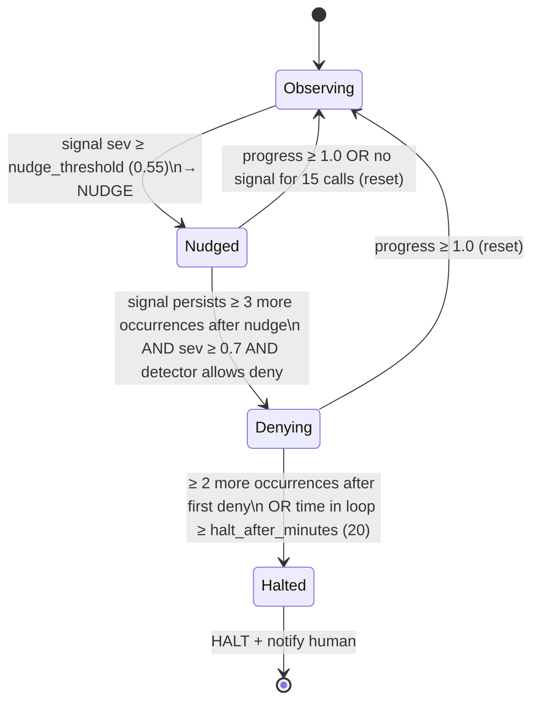

# LoopGuard: Low-Level Design (LLD)

| | |
|---|---|
| Status | Draft v0.1 |
| Date | 2026-10-19 |
| Depends on | [HLD.md](./HLD.md) |

This document specifies modules, data structures, algorithms, schemas, and interfaces precisely enough to implement from. Default thresholds are starting values and get tuned with the replay harness (see [TDD.md](./TDD.md) §6).

> **Hook API note:** The Claude Code hook fields below follow the official hooks reference (code.claude.com/docs/en/hooks) as of Oct 2026. Codex hooks are newer and still changing, so verify field names against developers.openai.com/codex/hooks for the installed Codex version. All agent-specific details live inside the adapters.

---

## 1. Repository layout

```
loopguard/
├── cmd/loopguard/main.go           # cobra root: hook, daemon, init, uninstall, doctor, status, report, replay, pause, tail
├── internal/
│   ├── event/                      # core types: Event, ToolCall, Decision, Signal
│   ├── adapter/
│   │   ├── adapter.go              # Adapter interface + registry
│   │   ├── claudecode/             # parse CC hook JSON, render CC decisions, install into settings.json
│   │   └── codex/                  # parse Codex hook JSON, render decisions, install into hooks.json/config.toml
│   ├── shim/                       # `loopguard hook`: stdin → daemon → stdout/exit, auto-start daemon
│   ├── daemon/                     # http server, auth, session manager, actors, lifecycle
│   ├── normalize/                  # text normalizer, command parser, error-signature extractor, simhash
│   ├── session/                    # SessionState, ring buffers, per-file history, progress tracker
│   ├── detect/                     # Detector interface + exact_repeat, repeated_failure, oscillation, read_thrash, stall, budget
│   ├── policy/                     # escalation state machine, cooldowns, message templates
│   ├── cost/                       # transcript tailer, usage dedupe, pricing, budgets
│   ├── notify/                     # desktop, ntfy, webhook (slack/discord), terminal-sequence
│   ├── store/                      # sqlite (modernc.org/sqlite), migrations, repositories
│   ├── replay/                     # offline transcript → event stream → detectors → report
│   ├── dashboard/                  # go:embed templates + htmx, REST handlers
│   ├── config/                     # config.yaml + .loopguard.yaml merge, defaults, validation
│   └── redact/                     # secret patterns
├── pricing.yaml                    # default model price table (user-overridable)
├── testdata/
│   ├── transcripts/                # anonymized real sessions (labeled)
│   └── hooks/                      # golden hook payloads per agent/version
├── scripts/                        # install.sh, release helpers
└── docs/
```

Dependencies (kept small): `spf13/cobra`, `modernc.org/sqlite`, `gopkg.in/yaml.v3`, `pelletier/go-toml/v2`, `gen2brain/beeep` (desktop notifications), `mvdan.cc/sh/v3/syntax` (bash parsing), and the standard library for HTTP.

---

## 2. Core types (`internal/event`)

```go
type AgentKind string // "claude-code" | "codex"

type Phase string // "pre" | "post" | "post_failure" | "batch_end" | "session_start" | "session_end" | "stop" | "prompt"

type Event struct {
    ID          string            // ulid
    Agent       AgentKind
    SessionID   string            // agent's session_id
    AgentID     string            // subagent id if any ("" = main agent)
    Phase       Phase
    ToolName    string            // normalized: "bash", "edit", "write", "read", "grep", "glob", "patch", "mcp:<server>:<tool>", "other:<name>"
    ToolUseID   string
    Input       json.RawMessage   // raw tool_input
    Output      json.RawMessage   // raw tool_response (post only)
    IsError     bool              // post_failure, or detected error in output
    Cwd         string
    Transcript  string            // transcript_path
    PermMode    string            // permission_mode ("auto", "bypassPermissions", ...)
    Prompt      string            // UserPromptSubmit only (stored hashed + truncated)
    ReceivedAt  time.Time
    Seq         uint64            // assigned by session actor
    Raw         json.RawMessage   // full payload, kept in memory only
}

type ToolCall struct {                // derived from a (pre, post) pair joined on ToolUseID
    Event        *Event               // the post event
    ActionFP     uint64               // see §4.2
    Family       string               // e.g. "npm test", "pytest", "go test"
    ResultFP     uint64               // hash of normalized output
    ErrorSig     *ErrorSignature      // nil if success
    FilePath     string               // for edit/write/read
    EditPair     *EditPair            // for edit: hashes of old/new strings
    FileHashAfter uint64              // content hash after write/edit (read from disk)
    Duration     time.Duration
}

type ErrorSignature struct {
    Exact   uint64   // xxhash of normalized key lines
    Sim     uint64   // 64-bit simhash of normalized tail
    Lines   []string // up to 5 key lines (redacted), for evidence/nudge text
}

type Signal struct {
    Detector  string   // "repeated_failure" ...
    LoopKey   string   // stable key for this loop instance, e.g. "rf:npm test:<errsig>"
    Severity  float64  // 0..1
    Count     int
    Since     uint64   // first seq in the loop
    Evidence  Evidence // human-readable facts: commands tried, error lines, files
}

type Action string // "none" | "nudge" | "deny" | "halt"

type Decision struct {
    Action   Action
    LoopKey  string
    Message  string   // text for the agent (nudge/deny) or the human (halt stopReason)
    Notify   bool
}
```

---

## 3. Adapters (`internal/adapter`)

```go
type Adapter interface {
    Kind() AgentKind
    Parse(raw []byte) (*event.Event, error)
    Render(ev *event.Event, d event.Decision) (stdout []byte, exitCode int)
    Install(opts InstallOpts) (InstallReport, error) // merge hooks, backup, idempotent
    Uninstall() error
    Doctor() []Check
}
```

### 3.1 Claude Code: event mapping

| Hook event | Phase | Notes |
|---|---|---|
| `SessionStart` | session_start | Records `source` (startup/resume/compact/fork), `model` if present, transcript path |
| `UserPromptSubmit` | prompt | Marks a human turn: **resets stall counters**. Also fires on scheduled tasks and `/loop`; treat `prompt_id` changes as turn boundaries |
| `PreToolUse` | pre | Enforcement point (deny) |
| `PostToolUse` | post | Main detection point |
| `PostToolUseFailure` | post_failure | `IsError = true` |
| `PostToolBatch` | batch_end | Batch boundary for parallel calls; can halt before the next model call |
| `Stop` | stop | End of a turn; session summary update |
| `SessionEnd` | session_end | Flush and finalize. Keep work tiny: the SessionEnd hook budget is short |

Tool name normalization: `Bash`/`PowerShell` → `bash`, `Edit`/`MultiEdit` → `edit`, `Write` → `write`, `Read` → `read`, `NotebookEdit` → `edit`, `Grep` → `grep`, `Glob` → `glob`, `mcp__srv__tool` → `mcp:srv:tool`, everything else → `other:<name>`.

### 3.2 Claude Code: rendering decisions

| Decision | Phase | Output (stdout JSON, exit 0) |
|---|---|---|
| none | any | no output, exit 0 |
| nudge | post / post_failure | `{"hookSpecificOutput":{"hookEventName":"PostToolUse","additionalContext":"<msg>"}}` (use `PostToolUseFailure` as the event name for failures) |
| deny | pre | `{"hookSpecificOutput":{"hookEventName":"PreToolUse","permissionDecision":"deny","permissionDecisionReason":"<msg>"}}` |
| halt | pre / post / batch_end | `{"continue":false,"stopReason":"<msg>","systemMessage":"LoopGuard halted this session: <short>"}` |
| notify (side effect) | any | may add `"terminalSequence":"\u001b]777;notify;LoopGuard;<msg>\u0007"` for a terminal notification |

Rules:
- Print **only** the JSON object on stdout; never print anything else from the shim.
- Never exit 2 from the shim. JSON decisions are explicit, and exit codes have per-event side effects.
- Nudge text must be **factual statements**, not imperative "system" instructions. The hooks docs warn that text framed as out-of-band system commands can trigger Claude's prompt-injection defenses (see §7.3 templates).
- Keep `additionalContext` well under the 10,000-character cap (target < 1,200 chars).

### 3.3 Claude Code: installed config

Merged into `~/.claude/settings.json` (user scope; `--project` flag → `.claude/settings.local.json`):

```json
{
  "hooks": {
    "SessionStart":       [{ "hooks": [{ "type": "command", "command": "loopguard", "args": ["hook", "--agent", "claude-code"], "timeout": 5 }] }],
    "UserPromptSubmit":   [{ "hooks": [{ "type": "command", "command": "loopguard", "args": ["hook", "--agent", "claude-code"], "timeout": 2 }] }],
    "PreToolUse":         [{ "matcher": "*", "hooks": [{ "type": "command", "command": "loopguard", "args": ["hook", "--agent", "claude-code"], "timeout": 2 }] }],
    "PostToolUse":        [{ "matcher": "*", "hooks": [{ "type": "command", "command": "loopguard", "args": ["hook", "--agent", "claude-code"], "timeout": 2 }] }],
    "PostToolUseFailure": [{ "matcher": "*", "hooks": [{ "type": "command", "command": "loopguard", "args": ["hook", "--agent", "claude-code"], "timeout": 2 }] }],
    "PostToolBatch":      [{ "hooks": [{ "type": "command", "command": "loopguard", "args": ["hook", "--agent", "claude-code"], "timeout": 2 }] }],
    "Stop":               [{ "hooks": [{ "type": "command", "command": "loopguard", "args": ["hook", "--agent", "claude-code"], "timeout": 2 }] }],
    "SessionEnd":         [{ "hooks": [{ "type": "command", "command": "loopguard", "args": ["hook", "--agent", "claude-code"], "timeout": 1 }] }]
  }
}
```

- Exec form (`args`) avoids shell quoting issues and works on Windows with a real `.exe`.
- The installer writes the **absolute path** of the binary into `command` when `loopguard` isn't on the PATH that Claude Code inherits.
- `onFailure` is never set to `"block"`, so LoopGuard stays fail-open.
- **Alternative (v0.3+):** `type: "http"` hooks pointing straight at the daemon save the process spawn. The trade-off: when the daemon is down, Claude Code shows a non-blocking hook-error notice. Offer it as an opt-in `--transport http`.
- Plugin packaging: the same structure in a plugin's `hooks/hooks.json`, with `${CLAUDE_PLUGIN_ROOT}/bin/loopguard`.

### 3.4 Codex: mapping (verify per version)

- Hooks are opt-in: the installer enables the hooks feature flag in `~/.codex/config.toml` (the key name has changed between versions, so detect by `codex --version`) and writes `~/.codex/hooks.json` with the same `{"hooks": {...}}` shape.
- Events used: `SessionStart`, `UserPromptSubmit`, `PreToolUse`, `PostToolUse`, `Stop` (plus `PostToolUseFailure`/`SessionEnd` where available).
- Tool names seen: `Bash`, `apply_patch`, `mcp__*`. Map `apply_patch` → `patch`, and parse the patch body to extract touched files and hunks so oscillation detection works for Codex too.
- Decisions: `PreToolUse` supports **deny only** (allow/ask are rejected, and it doesn't accept `additionalContext`). Deliver nudges via `PostToolUse` feedback/context, and halt via the stop/`continue:false` path that Codex supports on `PostToolUse`/`Stop`.
- Project-scope hooks load only for trusted projects, so the installer defaults to user scope.
- `Doctor()` must confirm the feature flag is on and that a test event reaches the daemon.

---

## 4. Normalization and fingerprints (`internal/normalize`)

### 4.1 Text normalizer

Applied to command strings and tool outputs before hashing:

1. Strip ANSI escape codes and `\r`-overwritten progress lines.
2. Replace with placeholders:
   - ISO/RFC timestamps, `HH:MM:SS(.mmm)` → `<TS>`
   - durations (`1.23s`, `450ms`, `in 3m2s`) → `<DUR>`
   - UUIDs, ULIDs, git SHAs (≥7 hex chars), hex addresses `0x…` → `<ID>`
   - absolute temp paths (`/tmp/...`, `/var/folders/...`, `%TEMP%`) → `<TMP>`
   - PIDs and ports in common phrases (`pid 1234`, `:54321`) → `<N>`
   - numbers with ≥4 digits → `<N>` (keep small numbers, since they're often meaningful: line numbers, counts)
3. Collapse whitespace; lower-case only for the *family* key (not the error signature).
4. Truncate inputs to 64 KB before processing.

### 4.2 Action fingerprint (`ActionFP`)

`xxhash64(tool + "\x00" + canonical(input))`, where canonical is:

| Tool | Canonical input |
|---|---|
| bash | normalized command (parsed with `mvdan/sh` and re-printed, so `npm  test` == `npm test`); env-var prefixes kept |
| edit | `path + hash(old_string) + hash(new_string)` |
| write | `path + hash(content)` |
| read | `path + offset + limit` |
| grep/glob | pattern + path |
| patch | sorted list of `(path, hunk_hash)` |
| mcp/other | canonical JSON (sorted keys) of input |

### 4.3 Command family

For bash: parse the AST and take the first "real" command of each pipeline/list (skipping `cd`, `export`, `source`, `time`, `env X=Y`). The family = first token + first non-flag subcommand token, e.g. `npm test`, `npx jest`, `pytest`, `go test`, `cargo build`, `python -m pytest` → `pytest`. Multi-command lines produce a family set; the primary family is the last command (usually the one whose result matters).

Built-in **polling families** (exempt from repeat detectors): `sleep`, `watch`, `gh run watch`, `gh pr checks`, `kubectl get … -w`, `curl …/health`, `docker ps`, `git status`, `ls`. Users extend this in config.

### 4.4 Error signature

Input: stderr+stdout tail (last 8 KB) of a failed call, or of a "soft failure" (exit 0 but the output matches failure markers, e.g. `FAILED`, `Error:`, `Traceback`, `panic:`, `npm ERR!`, `error[E`, `✕`, `AssertionError`).

1. Normalize (§4.1).
2. Select **key lines**: lines matching `(?i)(error|exception|fail(ed|ure)?|panic|traceback|assert|expected|undefined|cannot|not found|denied|refused|timeout)`. Keep the first 5 unique ones; if none match, use the last 5 non-empty lines.
3. `Exact = xxhash64(join(keyLines))`.
4. `Sim = simhash64(shingles(normalized tail, k=4 words))`.
5. Two signatures are the **same error** if `Exact` is equal OR `hamming(Sim) ≤ 4`.

### 4.5 File content hash

On post events for `edit`/`write`/`patch`, the daemon reads the file from disk (path resolved against `cwd`, size cap 2 MB) and stores `xxhash64(content)` in the file's history. Skipped for binaries and for files outside `cwd` and the project roots.

---

## 5. Session state (`internal/session`)

```go
type SessionState struct {
    Key        string                    // agent + ":" + session_id
    Agent      AgentKind
    StartedAt  time.Time
    LastSeen   time.Time
    Repo       string                    // git root of first cwd
    Calls      *Ring[ToolCall]           // last 200 completed calls
    Pending    map[string]*event.Event   // pre events by ToolUseID awaiting post
    Files      map[string]*FileHistory   // path → history
    Families   map[string]*FamilyStats   // family → stats
    Errors     map[uint64]*ErrorStats    // ErrorSig.Exact → stats (plus simhash bucket index)
    Progress   ProgressTracker
    Loops      map[string]*LoopState     // LoopKey → escalation state (policy)
    Usage      UsageTotals               // tokens, cost, from cost accountant
    Paused     bool
    TurnSeq    uint64                    // seq at last human prompt
}

type FileHistory struct {
    Hashes     []uint64   // content hash after each write (last 30)
    EditPairs  []EditPair // (oldHash, newHash) for each edit (last 30)
    Reads      int        // reads since last write to this file
    LastWrite  uint64     // seq
}

type FamilyStats struct {
    Runs, Fails     int
    ConsecFails     int
    LastErr         *ErrorSignature
    LastSuccessSeq  uint64
}
```

### 5.1 Progress tracker

Each completed call gets a **progress score** in `[0,1]`, which detectors use to reset or suppress:

| Signal | Score |
|---|---|
| A family that was failing now succeeds | 1.0 |
| Error signature for a family changed to a *new, never-seen* signature | 0.6 |
| Number of failing tests in output decreased (parse `N failed` / `N passed` patterns) | 0.6 |
| Write/edit to a file not touched before in this turn | 0.4 |
| Successful command of a family never run before | 0.3 |
| Task/todo marked completed (`TaskCompleted` / TodoWrite status change) | 0.8 |
| Anything else | 0.0 |

`Progress.Recent(n)` = sum of the scores over the last n calls.

---

## 6. Detectors (`internal/detect`)

```go
type Detector interface {
    Name() string
    Observe(s *session.SessionState, c *event.ToolCall) []event.Signal  // called after each completed call
}
```

All detectors look only at calls since the later of: the last human prompt (`TurnSeq`), or a window of the last 50 calls. **Default thresholds are configurable.**

### D1. Exact repeat
- **Fires when:** the same `ActionFP` and the same `ResultFP` occur ≥ **3** times in the window, and the family isn't a polling family.
- **LoopKey:** `er:<ActionFP>`
- **Severity:** `min(1, 0.5 + 0.15*(count-3))`

### D2. Repeated failure (headline detector)
- **Fires when:** the same family has ≥ **4** failures whose error signatures are the *same error* (§4.4), with **no success of that family** in between, and `Progress.Recent(since first failure) < 1.0`.
- Edits between attempts don't reset it. That's the point: "changing things but nothing changes".
- **LoopKey:** `rf:<family>:<ErrorSig.Exact of first occurrence>`
- **Severity:** `min(1, 0.55 + 0.1*(count-4))`, +0.1 if the same files are edited between attempts.
- **Evidence:** the family, count, key error lines, the files edited between attempts, and elapsed time.

### D3. Edit oscillation
- **Fires when**, for one file, either:
  - (a) **Inverse edits:** an edit with `(old=A, new=B)` followed later by `(old=B, new=A)`, at least **2** times; or
  - (b) **State revisit:** a content hash after a write equals one seen ≥2 writes earlier (A→B→A), at least **2** revisits within 20 writes.
- **LoopKey:** `os:<path>`
- **Severity:** 0.7 for (a), 0.6 for (b), +0.1 per extra revisit.

### D4. Read thrash
- **Fires when:** the same file is read ≥ **5** times with no write to it in between, AND `Progress.Recent(last 15) < 0.5`. Also covers repeated identical `grep`/`glob` searches (same ActionFP ≥ 4).
- **LoopKey:** `rt:<path or ActionFP>`
- **Severity:** 0.4 to 0.6. **Nudge only; this detector never escalates past nudge.**

### D5. No-progress stall
- **Fires when:** ≥ **25** consecutive calls have `Progress.Recent(25) < 0.5` and at least **8** of them are failures or re-reads.
- **LoopKey:** `st:<TurnSeq>`
- **Severity:** 0.5. It's lower-confidence, so it nudges once and notifies the human if `notify_on_stall` is set; no deny.

### D6. Budget
- Inputs: `Usage` (from the cost accountant), wall time, and tool-call count.
- **Soft limit:** signal severity 0.5 → notify only.
- **Hard limit:** severity 1.0 → halt.
- Limits per session, per day (global), and per repo: `cost_usd`, `tokens`, `wall_minutes`, `tool_calls`.
- **LoopKey:** `bg:<scope>:<limit>`

### 6.1 Deduplication across detectors

When D1 and D2 fire on the same calls, keep the signal with the higher severity per session per call (D2 wins ties, since it has the better message). Signals are passed to the policy engine sorted by severity.

---

## 7. Policy engine (`internal/policy`)

### 7.1 Escalation state machine (per `LoopKey`)



- **Observe-only mode** (`mode: observe`, the default for the first 3 days after install, configurable): the state machine runs and records "would have nudged/denied/halted", but every decision rendered is `none`. This builds trust and produces data.
- **Deny** applies only to the **looping action**: a `PreToolUse` whose `ActionFP` or family+recent-error matches the loop. Other actions pass.
- **Halt** ends the turn (`continue:false`). The session itself stays usable when the human returns; `Loops` state is reset on the next `UserPromptSubmit`.
- **Cooldown:** max 1 nudge per LoopKey per 10 calls, and max 3 nudges per turn overall.
- **Permission mode awareness:** in `default` (manual approval) mode, deny/halt thresholds are raised by 1 step, since a human is presumably watching. In `auto`/`bypassPermissions`/`dontAsk`, the normal thresholds apply.
- Detector capabilities: D1/D2/D3 can deny + halt; D4 nudge only; D5 nudge + notify; D6 notify + halt.

### 7.2 Decision timing

- Signals are produced on **post** events. If a nudge is due, it goes in the post response (`additionalContext`).
- Deny decisions are evaluated on **pre** events against `Loops` states currently in `Denying`.
- Halt decisions are rendered on the next event of any phase (pre, post, or batch_end), whichever comes first.

### 7.3 Message templates (factual tone)

Nudge, repeated failure:
```
LoopGuard observation: `{family}` has failed {count} times in the last {minutes} min with the same error:
  {error_line_1}
  {error_line_2}
Between attempts, these files were edited: {files}. The error did not change after any of these edits.
Repeating similar edits is unlikely to change the result. Options that often help: re-reading the full error and the code it points to, checking assumptions (versions, config, env), trying a different approach, or asking the user.
```

Deny:
```
LoopGuard blocked this command: it is the same `{family}` run that has failed {count} times with the same error, with no change in outcome. A different approach, or a question to the user, is needed before running it again.
```

Halt (stopReason, shown to the human):
```
LoopGuard halted the agent: stuck on `{family}` ({count} identical failures, {minutes} min, ~{cost}). See `loopguard report {short_session}`.
```

Oscillation:
```
LoopGuard observation: {path} has been changed back to a previous version {n} times (the same edit was made and then reverted). The two versions alternate between: {short_diff_summary}.
```

---

## 8. Cost accounting (`internal/cost`)

### 8.1 Transcript tailer
- When a `SessionStart` or first event arrives with `transcript_path`, register a tailer: poll every 2 s (fsnotify where available) and read from the stored byte offset.
- Parse JSONL lines; for assistant messages, extract `message.id`, `message.model`, and `message.usage.{input_tokens, output_tokens, cache_creation_input_tokens, cache_read_input_tokens}`.
- **Deduplicate by `message.id`** (a streamed message can appear on multiple lines; keep the max of each counter per id).
- Persist `(session, message_id, model, counters)`. Unknown lines are ignored (forward compatible).
- Codex: tail its session rollout JSONL (location and token-count event shape to be verified per version) through a `codex` tailer implementation behind the same interface.

### 8.2 Pricing
`~/.loopguard/pricing.yaml` (shipped default, user-editable, refreshable with `loopguard pricing update` from the repo):

```yaml
currency: USD
models:
  - match: "claude-opus-*"
    input_per_mtok: 0      # fill from the provider's current pricing page
    output_per_mtok: 0
    cache_write_per_mtok: 0
    cache_read_per_mtok: 0
  - match: "claude-sonnet-*"
    # ...
fx:
  INR: 0   # optional display conversion, user-set
```

Cost = Σ tokens × rate. For subscription users, the dashboard labels this **"API-equivalent cost"** and also shows token counts and time.

### 8.3 Budgets
Checked on every usage update and on every pre event, as D6 input. Because transcript usage lags by a few seconds, the hard limit is enforced **at the next tool call after crossing**. The docs must say so honestly.

---

## 9. Daemon (`internal/daemon`)

### 9.1 Process and transport
- Listens on `127.0.0.1:<port>`: default 47821, or the first free port, written to `~/.loopguard/daemon.json` along with the PID. Unix socket on macOS/Linux is optional later.
- Auth: header `Authorization: Bearer <token>` with the token from `~/.loopguard/token` (random 32 bytes, mode 0600). Dashboard routes accept a cookie set via a one-time link printed by `loopguard dashboard`.
- Single instance enforced by a PID file plus a port bind check.

### 9.2 Session manager and actors
```go
type Manager struct {
    mu       sync.Mutex
    actors   map[string]*Actor   // session key → actor
}
type Actor struct {
    in    chan job              // buffered (256)
    state *session.SessionState
}
type job struct { ev *event.Event; reply chan event.Decision }
```
- The ingest handler parses via the adapter, routes to the actor by session key, and waits on `reply` with the remaining time budget (the shim timeout minus 50 ms).
- The actor loop: assign `Seq` → update state → join pre/post → build `ToolCall` → run detectors → policy → write the decision to `reply` → enqueue async persistence (batched writer, flush every 200 ms or 100 rows).
- Actors are evicted after 2 h idle (state snapshot persisted) and rehydrated from SQLite on the next event.
- Each actor runs with `recover()`: on panic, log it, reply `none`, and rebuild state from the DB.

### 9.3 REST API (v1)

| Method & path | Purpose |
|---|---|
| `POST /v1/events?agent=claude-code` | Ingest one hook payload; returns `{"stdout": "...", "exit": 0}`, already rendered by the adapter |
| `GET /v1/sessions?since=&repo=` | List sessions with totals |
| `GET /v1/sessions/{id}` | Session detail: calls, signals, interventions, usage |
| `POST /v1/sessions/{id}/pause` / `resume` | Pause enforcement for a session |
| `GET /v1/stats?range=7d` | Loops caught, time and cost saved estimates |
| `GET /healthz`, `GET /metrics` | Health and Prometheus metrics |

The adapter renders on the daemon side so the shim stays dumb. Only the shim has to be backward-compatible across versions.

---

## 10. Hook shim (`internal/shim`)

```
loopguard hook --agent claude-code
```
1. If `LOOPGUARD_DISABLE=1` → exit 0.
2. Read all of stdin (cap 4 MB).
3. Read `~/.loopguard/daemon.json`; if it's missing or the connection is refused → spawn `loopguard daemon --detach` (rate-limited via a lock file, once per 10 s) and **exit 0 immediately**. This event is lost, which is acceptable.
4. `POST /v1/events` with a timeout of `min(800ms, hook timeout - 200ms)`.
5. On success: write `stdout` exactly and exit with `exit`. On any error or timeout: exit 0 with no output.
6. Never write to stderr except under `LOOPGUARD_DEBUG=1`.

Target cold-start of the Go binary: < 10 ms.

---

## 11. Storage schema (`internal/store`, SQLite, WAL)

```sql
CREATE TABLE sessions (
  key            TEXT PRIMARY KEY,         -- agent:session_id
  agent          TEXT NOT NULL,
  session_id     TEXT NOT NULL,
  repo           TEXT,
  cwd            TEXT,
  transcript     TEXT,
  model          TEXT,
  started_at     INTEGER NOT NULL,         -- unix ms
  last_seen_at   INTEGER NOT NULL,
  ended_at       INTEGER,
  tool_calls     INTEGER DEFAULT 0,
  input_tokens   INTEGER DEFAULT 0,
  output_tokens  INTEGER DEFAULT 0,
  cache_read     INTEGER DEFAULT 0,
  cache_write    INTEGER DEFAULT 0,
  cost_usd       REAL DEFAULT 0,
  loops_detected INTEGER DEFAULT 0,
  wasted_ms      INTEGER DEFAULT 0
);
CREATE INDEX idx_sessions_last_seen ON sessions(last_seen_at);

CREATE TABLE calls (
  session_key  TEXT NOT NULL,
  seq          INTEGER NOT NULL,
  ts           INTEGER NOT NULL,
  tool         TEXT NOT NULL,
  family       TEXT,
  file_path    TEXT,
  action_fp    INTEGER NOT NULL,
  result_fp    INTEGER,
  is_error     INTEGER NOT NULL,
  err_exact    INTEGER,
  err_sim      INTEGER,
  err_lines    TEXT,               -- redacted, ≤ 5 lines
  input_digest TEXT,               -- redacted, truncated (≤ 300 chars)
  progress     REAL,
  duration_ms  INTEGER,
  PRIMARY KEY (session_key, seq)
);

CREATE TABLE signals (
  id          INTEGER PRIMARY KEY,
  session_key TEXT NOT NULL,
  seq         INTEGER NOT NULL,
  detector    TEXT NOT NULL,
  loop_key    TEXT NOT NULL,
  severity    REAL NOT NULL,
  count       INTEGER,
  evidence    TEXT                -- JSON
);

CREATE TABLE interventions (
  id          INTEGER PRIMARY KEY,
  session_key TEXT NOT NULL,
  seq         INTEGER NOT NULL,
  loop_key    TEXT NOT NULL,
  action      TEXT NOT NULL,      -- nudge|deny|halt
  mode        TEXT NOT NULL,      -- enforce|observe (observe = would-have)
  message     TEXT,
  outcome     TEXT                -- filled later: recovered|continued_loop|halted|unknown
);

CREATE TABLE usage (
  session_key TEXT NOT NULL,
  message_id  TEXT NOT NULL,
  ts          INTEGER,
  model       TEXT,
  input_tokens INTEGER, output_tokens INTEGER, cache_read INTEGER, cache_write INTEGER,
  cost_usd    REAL,
  PRIMARY KEY (session_key, message_id)
);

CREATE TABLE transcript_offsets (path TEXT PRIMARY KEY, offset INTEGER NOT NULL, inode INTEGER);
CREATE TABLE schema_migrations (version INTEGER PRIMARY KEY, applied_at INTEGER);
```

- **Intervention outcome** is computed 10 calls after each intervention: `recovered` if progress ≥ 1.0 or the loop signal stopped; `continued_loop` otherwise. This is the core product metric ("nudge success rate").
- **Wasted time** for a loop = time from the first call in the loop (`Since`) to recovery or halt.
- **Retention:** a nightly job deletes `calls`/`signals` older than `retention_days` (30); `sessions` and `interventions` aggregates are kept.

---

## 12. Configuration (`internal/config`)

`~/.loopguard/config.yaml` (global) merged with `<repo>/.loopguard.yaml` (per repo; the repo file can only *tighten* budgets and *disable* detectors, never loosen global hard limits):

```yaml
mode: enforce            # observe | enforce
observe_days_after_install: 3
detectors:
  exact_repeat:     { enabled: true, min_count: 3 }
  repeated_failure: { enabled: true, min_count: 4 }
  oscillation:      { enabled: true, min_revisits: 2 }
  read_thrash:      { enabled: true, min_reads: 5 }
  stall:            { enabled: true, window: 25 }
policy:
  nudge_threshold: 0.55
  deny_after_nudges_occurrences: 3
  halt_after_deny_occurrences: 2
  halt_after_minutes: 20
  max_nudges_per_turn: 3
polling_families: ["sleep", "watch", "gh run watch", "gh pr checks", "git status"]
budgets:
  session: { soft_usd: 5, hard_usd: 15, wall_minutes: 180 }
  daily:   { soft_usd: 20, hard_usd: 50 }
notify:
  desktop: true
  terminal: true
  ntfy:    { topic: "" , server: "https://ntfy.sh" }
  webhook: { url: "", format: "slack" }   # slack | discord | generic
  on: [halt, budget_soft, budget_hard, stall]
privacy:
  retention_days: 30
  store_outputs: tail   # none | tail
```

---

## 13. Redaction (`internal/redact`)

Applied before anything is persisted or put in a notification: AWS keys, `sk-…`/`sk-ant-…` style API keys, GitHub tokens (`ghp_`, `github_pat_`), JWTs, private-key blocks, `password=`/`token=`/`secret=` key-value pairs, `.env`-style `KEY=value` lines where KEY contains SECRET|TOKEN|KEY|PASS. Replacement: `<REDACTED:type>`. Fingerprints are computed on the redacted text, so secrets never reach the DB, even hashed.

---

## 14. Replay (`internal/replay`)

```
loopguard replay [--agent claude-code] [--since 30d] [--path ~/.claude/projects] [--json] [--label]
```
- Reconstructs `Event`s from transcript JSONL (assistant `tool_use` blocks → pre; matching `tool_result` → post; `is_error` from the result) and feeds them through the **same** normalizer, detectors, and policy (forced observe mode).
- Output: a terminal report (sessions, loops, wasted time, API-equivalent cost, top loops with evidence), or JSON.
- `--label` opens an interactive TUI to mark each detected loop as true or false positive, and to mark missed loops by seq range. Labels are saved to `labels.jsonl` for the eval harness.

---

## 15. Notifications (`internal/notify`)

```go
type Notifier interface { Send(ctx context.Context, n Notification) error }
type Notification struct { Kind, Title, Body, SessionKey, Repo string; Severity float64 }
```
- **desktop:** beeep (macOS Notification Center, libnotify, Windows toast).
- **terminal:** the adapter attaches `terminalSequence` (OSC 777/9) to the next hook response. This works only in interactive sessions.
- **ntfy:** `POST {server}/{topic}` with Title/Priority headers. Free phone push with no account required.
- **webhook:** Slack `{"text":...}` / Discord `{"content":...}` / generic JSON.
- Sends happen async with retry (3×, exponential backoff); failures are logged and never block decisions.

---

## 16. Testing strategy

| Layer | Tests |
|---|---|
| normalize | Table tests: timestamps, durations, paths, simhash near-dup pairs (real pytest/jest/go test outputs) |
| adapters | Golden files: payload in `testdata/hooks/<agent>/<version>/*.json` → expected Event; Decision → expected stdout/exit |
| detectors | Scripted sessions (YAML DSL: "bash npm test → fail E1" ×4) → expected signals; property tests: polling families never fire |
| policy | State machine transition tests, including cooldowns and observe mode |
| shim | Daemon down, slow (timeout), and garbage-response cases all → exit 0, empty stdout |
| e2e | Spin up the daemon, run real `claude -p` in a sandbox repo with a deliberately unfixable failing test (e.g. a test asserting a wrong constant from a read-only file), and assert a nudge appears in the transcript and the halt happens |
| eval | `make eval`: replay the labeled corpus → precision/recall per detector, regression-gated in CI |
| perf | Benchmark: 10k events/session in < 1 s; shim round-trip p99 < 50 ms on CI hardware |